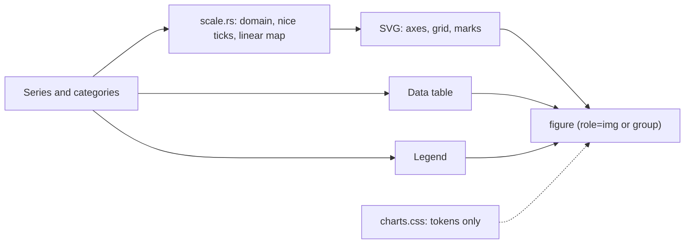

# ADR 0001: Script-Free SVG Charts with an Always-On Data Table

- Status: Accepted
- Date: 2026-11-06
- Tags: charts, widgets, accessibility, csp

## Context

autumn#3415 asks for charts v2: axes, legends, multi-series line and bar
charts, stacked bars, area and donut charts. Many component libraries hand
charts to Chart.js or ECharts. Those need a script, a canvas and a CSP
exception. Core autumn charts are one series, inline SVG, with an opt-in
data table.

## Options

1. Wrap a JS chart library.
2. Server SVG, plus a small script for tooltips.
3. Server SVG with no script. Hover details from `<title>` and CSS.

## Decision

Option 3.

- The server computes all geometry. It writes it in SVG attributes
  (`x`, `y`, `d`, `width`, `height`). No `style` attribute.
- The pack CSS holds the look. Each series gets a class
  `autumn-charts-s0`…`s5`: a token color, a dash pattern and a marker
  shape. Color is not the only cue.
- Each chart writes a data table. It is visually hidden by default. The
  app can show it, or put it in a `
`.
- Each mark has a `<title>`. `.focusable()` makes each mark a tab stop
  with an `aria-label`, and CSS shows a tip on `:hover` and
  `:focus-visible`. Then the SVG is `role="group"`, not `role="img"`,
  because an image has presentational children.
- `scale.rs` holds the math. It takes any `f64` and returns finite values.
  Proptests check it.

## Consequences

- Charts work with JavaScript off and under `script-src 'self'`.
- Output is deterministic. Snapshot tests catch each change.
- Text scales with the SVG. At a small width, labels are small.
- No zoom, pan or animation. An app that needs them uses a JS library.
- Six styles, then they repeat.
